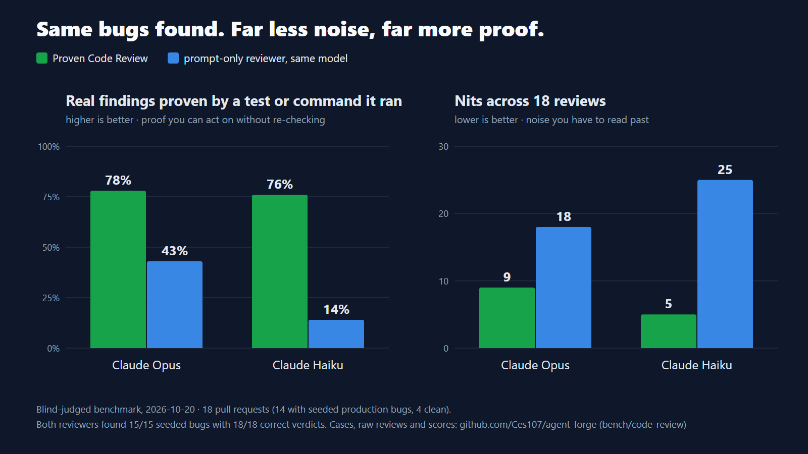

# agent-forge

**An idempotent double-entry payments ledger that stays exactly-once under concurrent retry storms,
and the multi-agent pipeline that built it. Every correctness claim is checkable from `git log` in 90
seconds.**

[](https://github.com/Ces107/agent-forge/actions/workflows/ci.yml)

## Skills catalogue

Every skill is a [SKILL.md](https://agensi.io/learn/skill-md-format) folder that runs in Claude Code,
Codex CLI, Cursor, Copilot, Gemini CLI and other agents. The paid ones ship their own tools (scripts
the agent runs), and each has a measured result in its `references/how-it-works.md`.

### Free (this repo, MIT)

```bash
/plugin install agent-forge --marketplace Ces107/agent-forge   # Claude Code, as a plugin
npx skills add Ces107/agent-forge                               # any SKILL.md agent
```

| Skill | What it does | Also on |
|---|---|---|
| [`done-gate`](skills/done-gate) | **New, free:** a Claude Code hook that blocks "done" until the tests really ran green after the last edit. Checks the commands that ran, not what the agent says | free |
| [`proven-code-review`](skills/proven-code-review) | Code review that reads beyond the diff, tries to refute every suspicion, and proves each serious bug with a failing test it ran. [Benchmarked in public](bench/code-review) | [Agensi](https://agensi.io/skills/ai-code-review-skill-every-bug-gets-a-failing-test?utm_source=github&utm_medium=readme&utm_campaign=catalogue) |
| [`spec-trace-gate`](skills/spec-trace-gate) | Fails when a spec requirement has no task, a task cites a phantom requirement, or a task names a test that does not exist | [Agensi](https://agensi.io/skills/requirements-traceability-gate-every-spec-has-a-test?utm_source=github&utm_medium=readme&utm_campaign=catalogue) |
| [`verify-gate`](skills/verify-gate) | Runs the real tests, coverage, lint, types and security scan; `VERIFY: PASS` only on all-zero exit codes | [Agensi](https://agensi.io/skills/verify-gate-no-done-without-real-exit-codes?utm_source=github&utm_medium=readme&utm_campaign=catalogue) |
| [`adversarial-review-gate`](skills/adversarial-review-gate) | A review that must break the code: findings count only with a failing test, ending in `GATE: PASS/FAIL` | [Agensi](https://agensi.io/skills/adversarial-code-review-findings-need-a-failing-test?utm_source=github&utm_medium=readme&utm_campaign=catalogue) |

Or copy a folder from `skills/` into `~/.claude/skills/` (all projects) or `.claude/skills/` (one
project). `python skills/build.py` pre-flights every skill against marketplace scanner rules, keeps
the bundled gate scripts identical to `forge/`, and writes the zips to `dist/skills/`.

[](bench/code-review)

### Paid (Agensi)

**Agent guardrails**

| Skill | What it does | Price | Get it |
|---|---|---|---|
| Proof-of-Done | Claude Code hooks that block "done" until the tests really ran green after the last edit, and catch deleted or weakened tests | $15 | [Agensi](https://agensi.io/skills/claude-code-hooks-block-done-until-tests-really-pass?utm_source=github&utm_medium=readme&utm_campaign=catalogue) |
| Command Guard | Blocks rm -rf, git reset --hard and force pushes only when they would really lose work | $9 | [Agensi](https://agensi.io/skills/claude-code-safety-guard-block-destructive-commands?utm_source=github&utm_medium=readme&utm_campaign=catalogue) (in review) |
| Phantom Dependency Guard | Checks every pip/npm/cargo install for typosquats and hallucinated package names before it runs | $15 | [Agensi](https://agensi.io/skills/fake-package-blocker-stop-ai-hallucinated-dependencies?utm_source=github&utm_medium=readme&utm_campaign=catalogue) |
| Context Checkpoint | Saves your rules, goal, edited files and last test result before /compact and puts them back after | $12 | [Agensi](https://agensi.io/skills/claude-code-memory-saver-rules-survive-compaction?utm_source=github&utm_medium=readme&utm_campaign=catalogue) |
| API Reality Check | Checks every import, attribute and keyword argument in AI-written Python against the library you installed | $15 | [Agensi](https://agensi.io/skills/hallucinated-api-detector-catch-calls-that-don-t-exist?utm_source=github&utm_medium=readme&utm_campaign=catalogue) (in review) |

**Faster debugging and testing**

| Skill | What it does | Price | Get it |
|---|---|---|---|
| Test Impact Selector | Maps your git diff to the tests it can break and prints the exact command to run | $19 | [Agensi](https://agensi.io/skills/smart-test-runner-run-only-the-tests-you-affected?utm_source=github&utm_medium=readme&utm_campaign=catalogue) |
| Flaky Test Bisector | Measures a flaky test's failure rate and bisects test order to name the polluting test | $12 | [Agensi](https://agensi.io/skills/flaky-test-finder-catch-the-test-that-breaks-others?utm_source=github&utm_medium=readme&utm_campaign=catalogue) |
| Log Distiller | Turns gigabytes of logs into a 2 KB summary with the real error on top | $12 | [Agensi](https://agensi.io/skills/log-analyzer-gigabytes-of-logs-to-the-real-error?utm_source=github&utm_medium=readme&utm_campaign=catalogue) |
| Query Log Lens | Ranks N+1 and duplicate queries in a SQL log and gives the ORM fix | $12 | [Agensi](https://agensi.io/skills/n-1-query-detector-find-slow-orm-queries-in-logs?utm_source=github&utm_medium=readme&utm_campaign=catalogue) (in review) |
| Perf Regression Gate | Runs old and new code alternately and reports the slowdown with a confidence interval | $15 | [Agensi](https://agensi.io/skills/performance-regression-detector-prove-it-got-slower?utm_source=github&utm_medium=readme&utm_campaign=catalogue) (in review) |
| Diff Coverage Gate | Shows which changed lines no test runs, with a CI gate | $9 | [Agensi](https://agensi.io/skills/diff-coverage-checker-tests-for-every-changed-line?utm_source=github&utm_medium=readme&utm_campaign=catalogue) |
| Migration Lock Linter | Flags Postgres/MySQL migrations that lock or rewrite tables and suggests the zero-downtime version | $19 | [Agensi](https://agensi.io/skills/safe-database-migration-checker-no-table-locks?utm_source=github&utm_medium=readme&utm_campaign=catalogue) (in review) |

**Web design and SEO**

| Skill | What it does | Price | Get it |
|---|---|---|---|
| Site Polish Audit | Renders a page at three widths, scores the design 0-100 and hands the agent a ranked fix list with screenshots | $19 | [Agensi](https://agensi.io/skills/website-design-auditor-make-ai-built-sites-look-pro?utm_source=github&utm_medium=readme&utm_campaign=catalogue) |
| Landing Page Studio | Turns a one-line brief into a responsive landing page, checked in light and dark at three widths | $19 | [Agensi](https://agensi.io/skills/landing-page-designer-your-ai-builds-pro-pages?utm_source=github&utm_medium=readme&utm_campaign=catalogue) (in review) |
| GEO + SEO Audit | Crawls a site against 67 rules for Google and AI search and writes the fix files | $19 | [Agensi](https://agensi.io/skills/geo-seo-audit-crawler-get-found-by-ai-search?utm_source=github&utm_medium=readme&utm_campaign=catalogue) |

**Pipeline**

| Skill | What it does | Price | Get it |
|---|---|---|---|
| agent-forge Pipeline | The whole Spec, Architect, Tasks, Implement, Review, Verify pipeline: five sub-agent roles, gates and loop rules | $24 | [Agensi](https://agensi.io/skills/claude-code-multi-agent-pipeline-spec-to-verified-build?utm_source=github&utm_medium=readme&utm_campaign=catalogue) |
| Ledger Correctness Kit | Property-based and concurrency test suite for any double-entry ledger, plus design rules and a checklist | $24 | [Agensi](https://agensi.io/skills/payments-ledger-test-suite-catch-double-charges-races?utm_source=github&utm_medium=readme&utm_campaign=catalogue) |

## The 90-second proof

An adversarial review agent in the build pipeline caught a real concurrency bug that the implementer
missed: under lock contention beyond `busy_timeout`, `BEGIN IMMEDIATE` raised
`sqlite3.OperationalError: database is locked`, which leaked unhandled as HTTP 500 and broke the
"exactly-once under retry storms" guarantee. The catch, the failing test, and the fix are three
consecutive commits you can read:

```bash
git show 708ee99   # reviewer@agent-forge.bot: a deliberately RED regression test (GATE: FAIL)
git show 49fa176   # implementer@agent-forge.bot: the fix (bounded retry/backoff, typed 503 + Retry-After)
git show 998e7f4   # verifier@agent-forge.bot: re-ran every check to green (VERIFY: PASS)
```

The red commit is the evidence: a review stage that adds value, not a rubber stamp. The full
walk-through is in [`AUTONOMOUS-TRAJECTORY.md`](AUTONOMOUS-TRAJECTORY.md).

## The correctness model (`workspaces/ledger/`)

A payments ledger scoped to the single hardest correctness problem: exactly-once money movement under
concurrent retry storms. The design is the idiom a payments engineer reaches for, and that most
candidates get wrong:

- **Balance is a fold over an append-only `postings` table**, never a mutable balance column. Mutable
  balances are the classic source of lost-update and reconciliation bugs.
- **The idempotency key is claimed atomically inside the `BEGIN IMMEDIATE` write transaction, before
  validation.** The unique-constraint insert *is* the atomic claim, so two concurrent duplicates can
  never both proceed. Most implementations insert the key in a separate transaction and race.
- **The overdraft check runs inside the same write lock** as the postings, so a balance cannot be
  driven below its floor by an interleaving.
- **Both postings (debit + credit) and the key commit in one transaction, or none do.** A crash
  between them leaves the books closed (see the crash-recovery test below).
- **A typed exception hierarchy maps to HTTP** 404 / 409 / 422 and 503 + `Retry-After`. A lock-timeout
  is a 503 a client should retry, not a 500.

Correctness is **enforced, not asserted**, by a Hypothesis `RuleBasedStateMachine`
(`tests/test_properties.py`): it generates random sequences of account creation, transfer, and replay,
and after **every** step checks five double-entry invariants against the database:

1. global conservation: `sum(debits) == sum(credits)`,
2. each account balance equals the fold of its postings,
3. no balance below its floor,
4. every `transfer_id` has exactly two postings of equal magnitude,
5. no idempotency key maps to more than one transfer.

This is how you prove a ledger correct, rather than happy-path unit tests. Plus a real crash-recovery
test (`tests/test_crash_recovery.py`): it kills the process between the debit and the credit (a
`BaseException` escaping the rollback handler, simulating SIGKILL), drops the connection, opens a fresh
one, and asserts the books still close with no half-transfer.

```text
50 passed,  98% coverage,  ruff + mypy --strict + bandit all exit 0
```

### Run it end-to-end (no GPU, no external services)

```bash
cd workspaces/ledger && pip install -e ".[dev]" && python -m pytest      # or: docker compose up --build
uvicorn ledger.api:app                                                   # then, over HTTP only:
curl -XPOST localhost:8000/accounts  -d '{"account_id":"bank","balance_floor":-1000000000}'
curl -XPOST localhost:8000/accounts  -d '{"account_id":"alice"}'
curl -XPOST localhost:8000/transfers -d '{"idempotency_key":"k1","from_account":"bank","to_account":"alice","amount":500}'
curl      localhost:8000/reconciliation     # {"total_debits":500,"total_credits":500,"balanced":true,...}
```

## From SQLite to a distributed payments system

SQLite with `BEGIN IMMEDIATE` is a deliberate scope choice: single-writer serial semantics make the
correctness model trivially provable, which is the point of the demo. The same primitives map onto a
distributed Postgres-backed system without changing the correctness model:

| Here (single host) | Distributed equivalent |
|---|---|
| `idempotency_keys` PRIMARY KEY, claim-before-validate | Postgres `UNIQUE` + `INSERT ... ON CONFLICT DO NOTHING` |
| `BEGIN IMMEDIATE` serial write lock | `SELECT ... FOR UPDATE` / advisory lock / `SERIALIZABLE` isolation |
| `busy_timeout` + bounded retry/backoff | a transactional **outbox** drained by a polling worker |
| two postings in one local transaction | cross-service atomicity via **saga / choreography** with compensations |
| one key store, one writer | partitioned key ownership, or a single authoritative key service, per region |

The hard problem in production is distributed idempotency across app servers; this repo isolates and
proves the correctness kernel that every one of those designs still has to get right.

## What this does NOT cover (and why)

Deliberate exclusions, so the kernel stays small enough to hold in your head: multi-node idempotency,
FX and multi-currency, settlement finality, the difference between a ledger entry and an instruction
sent to a payment rail, async sagas, auth. One known accepted limitation is documented as F-002 in
[`forge/reviews/REVIEW-001.md`](forge/reviews/REVIEW-001.md): error responses are not idempotency-cached
(a failed transfer rolls back its key claim, so a retry re-executes rather than replaying the original
error). Stripe caches error responses; this ledger deliberately does not, and says so.

## The pipeline that built it (`forge/`)

The ledger's application code was written entirely by Claude Code sub-agents, one per SDLC stage, with
restricted toolsets and explicit model tiers:

```
Spec ─▶ Architect ─▶ Tasks ─▶ Implement ─▶ AdversarialReview ─▶ Verify ─▶ Commit
(opus)   (opus)       (sonnet)  (sonnet)     (sonnet)             (haiku)
```

This is spec-driven development (after GitHub Spec Kit, AWS Kiro, BMAD) with the spec-to-code link made
machine-checkable: a CI gate enforces a bijection between every EARS acceptance criterion (`AC-N`), a
task, and a real test (`make trace`), and a verify gate halts unless tests, coverage, `ruff`,
`mypy --strict` and `bandit` all pass. The verify gate actually halted twice on the first run (coverage
68% < 80%, 11 ruff findings) before going green, which is the point: the gate measures substance.
Re-run the build yourself with the `claude` CLI: `make pipeline`.

## Author

César Pereiro. I build correctness-critical software in a regulated medical-software company (HL7,
DICOM, FHIR hospital integrations under EU MDR, GDPR and EHDS). Money-movement discipline and
clinical-data discipline are the same discipline: exactly-once, no silent loss, auditable end to end.

## Appendix: provenance and tooling

For reviewers who want to check that the agent-built claim is real rather than asserted: the
autonomous **build** of the ledger is authored by per-role agent identities
(`implementer@agent-forge.bot`, `reviewer@agent-forge.bot`, `verifier@agent-forge.bot`), verifiable in
`git log`. Since then I maintain the code as engineer-of-record under my own name, openly. The honest
claim is therefore precise: the build was agent-authored, and only the named engineer has touched the
application code since. `hooks/audit_provenance.py` enforces exactly that (it fails on any *foreign*
author of `workspaces/ledger/src`) and prints the split. Because an author email is spoofable, a
tamper-evident hash-chain attestation ledger (`forge/attestation.py`, after in-toto / SLSA) additionally
binds each build stage to the SHA-256 of the artifacts it produced; `make attest` re-derives every digest
and fails at the exact link if anything was altered. The harness (`forge/`) is human-authored throughout.
Field context and design notes: [`docs/STATE-OF-THE-ART.md`](docs/STATE-OF-THE-ART.md).
